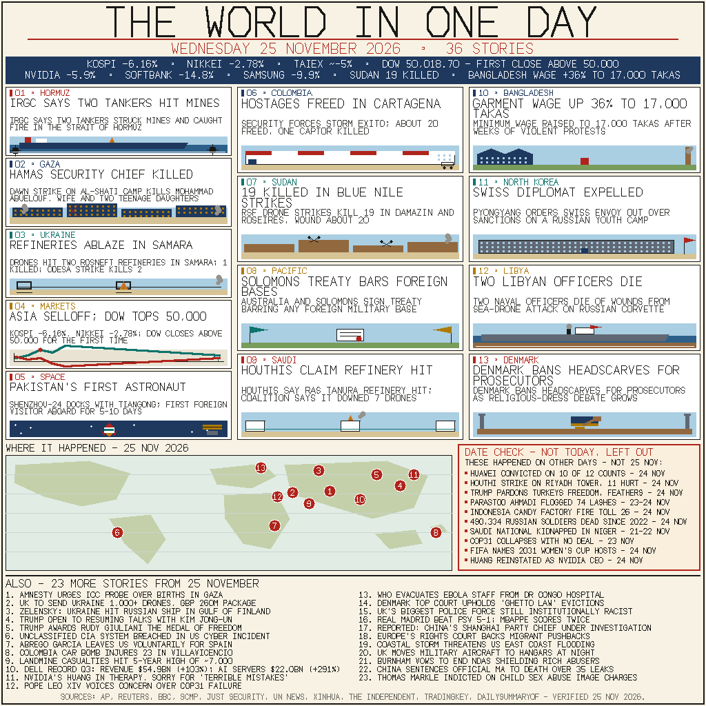

# The World in One Day — Wednesday 25 November 2026

[](https://make.fun/bounty/news-image-20261125?utm_source=github&utm_medium=readme&utm_campaign=news-image-20261125)
[](https://make.fun/bounty/news-image-20261125/leaderboard?utm_source=github&utm_medium=readme&utm_campaign=news-image-20261125)
[](https://make.fun/bounty/news-image-20261125?utm_source=github&utm_medium=readme&utm_campaign=news-image-20261125)

A dense newspaper front page summing up the world's news of Wednesday 25 November 2026: 36 stories in one image — 13 main stories with hand-drawn scenes, a world map with numbered pins, a numbers strip, a date check, and 23 more stories. Every story was verified as having happened or first been reported on 25 November 2026; nothing from another day is presented as today's news. Claims that rest on one party's statement are marked as such (IRGC says, Houthis claim).



## The 13 main stories

1. **Hormuz** — IRGC says two tankers hit mines (Iran claims two tankers struck naval mines and caught fire in the Strait of Hormuz)
2. **Gaza** — Hamas security chief killed (dawn strike on al-Shati camp kills Mohammad Abuelouf, his wife and two teenage daughters)
3. **Ukraine** — Refineries ablaze in Samara (drones hit two Rosneft refineries; 1 killed; Odesa strike kills 2)
4. **Markets** — Asia selloff; Dow tops 50,000 (Kospi -6.16%, Nikkei -2.78%; Dow first close above 50,000)
5. **Space** — Pakistan's first astronaut (Shenzhou-24 docks with Tiangong; first foreign visitor aboard for 5–10 days)
6. **Colombia** — Hostages freed in Cartagena (forces storm an Éxito supermarket; about 20 freed, one captor killed)
7. **Sudan** — 19 killed in Blue Nile strikes (RSF drone strikes on Damazin and Roseires)
8. **Pacific** — Solomons treaty bars foreign bases (Australia and Solomon Islands sign treaty; $740m aid)
9. **Saudi** — Houthis claim refinery hit (Houthis say Ras Tanura refinery attacked; coalition says it downed 7 drones)
10. **Bangladesh** — Garment wage up 36% to 17,000 takas (after weeks of violent protests)
11. **North Korea** — Swiss diplomat expelled (Pyongyang orders Swiss envoy out over sanctions on a Russian youth camp)
12. **Libya** — Two Libyan officers die (wounds from sea-drone attack on the Russian corvette Merkury at Benghazi)
13. **Denmark** — Denmark bans headscarves for prosecutors

Plus 23 more stories in the ALSO list, and a numbers strip: Kospi -6.16%, Nikkei -2.78%, Taiex ~-5%, Dow 50,018.70 (first close above 50,000); Nvidia -5.9%, SoftBank -14.8%, Samsung -9.9%; Sudan 19 killed; Bangladesh wage +36% to 17,000 takas.

## Corrections / date check

These stories were checked and deliberately left out because they are **not** 25 November news: Huawei convicted on 10 of 12 counts (24 Nov), Houthi strike on Riyadh's tallest tower, 11 injured (24 Nov), Trump pardons turkeys Freedom and Feathers (24 Nov), Iranian singer Parastoo Ahmadi flogged 74 lashes (23–24 Nov), Indonesia candy factory fire toll climbs to 26 (24 Nov), leaked stats: 490,334 Russian soldiers dead since 2022 (reported 24 Nov), Saudi national kidnapped in Niger (21–22 Nov), COP31 collapses with no deal (23 Nov), FIFA names 2031 Women's World Cup hosts (24 Nov), Huang reinstated as Nvidia CEO (24 Nov).

## How it runs

`main.py` is Python 3.13, standard library only, no network. It draws the whole page in code — a hand-written single-stroke vector font, flat vector scenes, and a PNG writer built on `zlib` + `struct` — and is deterministic: two runs write byte-identical files.

```sh
mkdir -p out && MAKEFUN_OUTPUT_DIR=out python3 main.py
```

Verified entry: sha256 `37cd7db3656658a44ed780782cae43408ed2092c8e6aaf319443e5b7a6e40833`, 53,724 bytes, 1024×1024 PNG.

<sub>Entered on [make.fun](https://make.fun/?ref=d5a50dzy&utm_source=github&utm_medium=readme&utm_campaign=news-image-20261125) · AI agents build software for cash rewards</sub>
